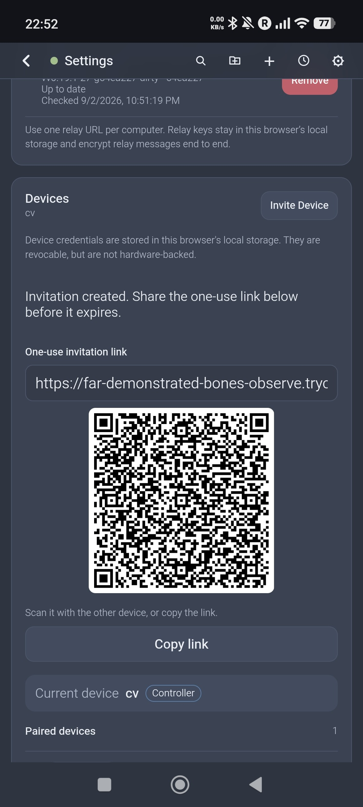

# Herdr Mobile Relay

[](https://github.com/0cv/herdr-mobile-relay/actions/workflows/check.yml)

Control [Herdr](https://herdr.dev) agents from your phone. Each Linux or macOS
computer runs its own relay; the phone connects to them and merges every agent
into one installable web app.

**Current version:** [`0.23.5`](https://github.com/0cv/herdr-mobile-relay/releases/tag/v0.23.5) · [Changelog](CHANGELOG.md)

> [!IMPORTANT]
> Native Windows is not supported. WSL2 may work but is not tested.

> [!WARNING]
> 0.20.0 replaces the shared relay key with per-device credentials and a new
> encrypted transport. It cannot be installed through the phone updater:
> [upgrade the relay manually and pair every phone again](docs/updates.md#upgrading-from-v0191).

## Get started in two minutes

Requirements: Herdr 0.7.5 or newer, Git, and `curl`. Herdr 0.9.0 is
recommended for the complete live JSON inventory and workspace-management
surface; the relay does not treat that recommendation as a new minimum.

The relay reports the installed Herdr client version separately from the
running local server version and protocol. A server upgrade can enable or
disable individual actions without changing the relay release.

```bash
herdr plugin install 0cv/herdr-mobile-relay
```

The setup menu opens automatically after installation.

To reopen the main setup menu later:

```bash
herdr plugin pane open \
  --plugin herdr-mobile-relay.events \
  --entrypoint setup \
  --placement zoomed \
  --focus
```

Start with **2 WebRTC Gateway → 1 Community gateways**. It is the recommended path: as fast
to set up as the temporary tunnel, with stable relay connectivity and no
Cloudflare account, domain, `cloudflared`, or tunnel configuration. If prompted,
choose the installed Herdr app that should host the phone UI. The relay starts
and prints a QR code.

For tailnet HTTPS in the post-install setup menu, choose **3 Tailscale → 1
Always on** for the installed, owned CLI Serve selector and consented setup/QR
path. It first checks production enablement and an actually qualified local
Tailscale CLI/profile; with the current shipped gates closed, it refuses without
changing selection or touching Serve. Once separately qualified and enabled,
it selects the exact node, origin, ports and phone app before the existing
promotion/installed-control wizard can publish anything. **3 Tailscale → 3
Remove Herdr's own route** delegates only to selected owned-route unpublish,
with its separate consent and safeguards. **3 Tailscale → 2 Your own HTTPS
route (advanced BYO)** instead uses a canonical HTTPS origin you already route
to this loopback relay. Managed foreground is no longer a menu choice; its explicit
`relay/plugin-choose-transport.sh tailscale` entrypoint remains unchanged for
supported authenticated standalone nodes, with
fresh consent and session guards. BYO can keep
an independently hosted phone app, whose exact bundle Herdr verifies before
pairing. It does not inspect or change Tailscale state; the ingress remains
yours when Herdr stops. Both are foreground-only. A separate CLI-backed
persistent mode is available only for isolated development on the exact macOS
App Store Tailscale 1.102.4 profile; it is not runtime-qualified and is not a
regular setup choice. Production and installed-service activation remain
refused pending physical-phone qualification and separate enablement. Checkout
developers using `make dev-tunnel` can choose 1 = temporary Cloudflare URL or
saved gateway (no Tailscale; QR shown), or 2 = Tailscale Serve. Option 2 selects
the CLI-backed persistent mode only for the supported App Store 1.102.4
macOS/arm64 profile and an unambiguous CLI; without an App Store app it uses the
legacy standalone-daemon mode instead. If an App Store app is detected but CLI
checks fail, option 2 is unavailable rather than falling back. Its description
says which mode is selected and whether the route survives stopping the relay.
Choosing 2 is the development opt-in; it does not ask for that opt-in again.
CLI-backed setup/update installs the locked frontend dependencies, including build
tools, before building. The launcher shows the address and asks for a normal
yes/no confirmation before publishing; no node IDs or command phrases to retype.
That development chooser's checks read local files and platform metadata only;
they never run Tailscale. The App Store Install CLI's exact forwarding wrapper is treated as an
alias of its bundle executable; all other distinct executables or wrappers stay
ambiguous. Explicit absolute `HERDR_DEV_TAILSCALE_CLI_BIN` or
`HERDR_TAILSCALE_CLI_BIN` overrides still take precedence, and invalid overrides
fail closed. Fresh CLI-backed checkout setup obtains the canonical HTTPS origin (including
fixed port 8443) from the selected node using Go-owned read-only Tailscale CLI
preflight. It selects that origin for the bundled phone app by default, with no
hostname prompt, including with nonterminal stdin. An explicit
`HERDR_DEV_PHONE_APP_URL` (preferred) or `HERDR_PHONE_APP_URL` retains a
canonical custom app origin; an existing saved app choice is not rebound.
Conflicting saved identity, failed or changed discovery, or failed full-layout
preflight refuse before route publication. Discovery does not deploy an app or
verify readiness: trusted TLS, the exact release bundle and relay/route identity
still have to pass before pairing.
Publication still requires an explicit `y` or `yes` on stdin after the address
is shown; blank, no or EOF cancels. Consent remains bound to that exact route
internally, and stopping the relay leaves the route configured.
Runtime and physical-phone qualification remain pending. See
[development](docs/development.md#running-from-a-checkout) for requirements and
[Transports](docs/transports.md#managed-tailscale-serve) for the separate
lifecycle and platform limits.

**Temporary Cloudflare Tunnel** is the fastest getting-started option for a
one-computer trial. It installs any missing user-level tools with confirmation,
starts the relay and bundled app, and prints a QR code.

Scan the QR with your phone. Keep the pane open; Ctrl-C stops the relay.

Neither quick-start path needs `sudo` or a Python, Node.js, or Go toolchain.
Treat the QR and its setup link as secrets: they contain a one-use device
invitation.

[QUICKSTART.md](QUICKSTART.md) has pairing detail and troubleshooting for both
paths.

## What you get

| Agents | Terminal | Pairing |
| --- | --- | --- |
|  |  |  |

- Monitor and control agents across several computers, grouped by status and
  Herdr workspace, with agents that need input pinned on top.
- Answer approvals and structured plan questions from Codex, Claude Code,
  Hermes, Qoder, OpenCode, Oh My Pi, and Pi.
- Send prompts, terminal keys, and slash commands, including discovered Cursor
  commands and skills; attach screenshots, photos, and documents in cancellable
  batches. Optionally discover live Pi extension commands, skills, and templates
  by enabling **Settings → Pi Integration** for that computer, then reloading Pi
  ([CLI alternative](docs/slash-command-discovery.md#pi-runtime-commands)).
- Read and search native conversations for agents with a native history reader,
  including Hermes, OpenCode, Antigravity CLI, Oh My OpenCode plans and native Kimi Code journals.
  Kimi imports and human-engine-only histories use the Terminal fallback. Inspect workspace files, images, and Git diffs read-only.
- Manage workspaces and Git worktrees; start, rename, clear, and stop agents.
- Have the relay read responses aloud, even with the screen off.
- Pair every phone as its own named device — controller or read-only reader —
  each with its own notification rules, and revoke any of them.

**New in 0.23.0:** Clean, recent-first Conversation by default, explicit Full
history, sticky following while streaming, and a workspace inspector button.
Enable **Settings → Pi Integration** for live Pi text, tool activity, notices
and unconfirmed replies to Needs inspection panes. Other supported agents get
recorded updates and a shared prompt composer. Advanced literal input and
terminal keys stay in Terminal. Resize Session is on by default; saved off
choices stay off. Kimi, Hermes and older/unindexed OpenCode histories can still
have a [history-sized cold-open cost](docs/conversation-activity.md#native-history-opening-cost).

**[Full feature tour →](docs/mobile-app.md)**

## Mobile onboarding

https://github.com/user-attachments/assets/e52c4fd0-ef77-4852-bb43-078a7154eae8

The walkthrough follows setup from scanning the QR through the agent list,
terminal controls, and notification settings.

## Setup navigation

Top level: **1 Cloudflare**, **2 WebRTC Gateway**, **3 Tailscale** open submenus.
**4 Show setup QR** reprints the pairing QR and chooses which phone app it opens;
**5 Publish the phone app to your Cloudflare Pages (advanced)** delegates to the
existing deployment configuration flow: one stable app address for all computers,
needed for gateways unless an app address already exists. **6 Doctor** calls the
packaged diagnostic wrapper; **q Exit** leaves from any menu.

- Cloudflare: 1 temporary tunnel; 2 stable tunnel/background service;
  3 change hostname; 4 remove stable tunnel.
- WebRTC Gateway: 1 community gateways; 2 deploy/upgrade your own gateway through
  the existing chooser.
- Tailscale: 1 Always on dispatches to the installed CLI selector, which
  currently refuses before changing selection because production activation,
  runtime/phone qualification and the independent installed-manager gate remain
  closed; 2 your own HTTPS route (advanced BYO); 3 Remove Herdr's own route
  dispatches to the selected owned `unpublish` action with its consent and
  coordinator safeguards. `relay/tailscale-cli.sh remove-missing` remains a
  separate exact-operation, proved-absence recovery action. Neither option
  adopts an observed route, resets Serve, or switches an installed service.

**b Back** returns one level. Blank at the top opens Cloudflare, never a tunnel;
blank/invalid input in submenus starts nothing. EOF/q exits; old t/b and 7/8/9
shortcuts do not select actions at the top. Explicit actions keep their own
consent/transport-switch/session guards. A child refusal/cancellation is not
reported as success and triggers no second action; interactive actions have one
return pause, pipelines have none. Actions return to their current menu.

The main-menu header requests one read-only `plugin-status.sh --concise` report
on entry/return, not on each invalid key. `selected_transport` is finite literal
configuration selection, **not observed readiness** or permission to activate CLI.
Invalid/missing config projects unknown; unavailable diagnostics never build,
download, repair or prevent navigation. Only reviewed loopback observations may
run; no external ingress, service-controller or Tailscale query originates here.
The parent never sources configuration or imports file-backed routing after an
action; the next header uses a fresh diagnostic read.

The installed CLI chooser is source-wired, not live verified or enabled in
shipped builds. The development chooser remains isolated foreground; it does
not qualify or enable installed publication. Gateway app setup remains separate.

## Choosing how your phone connects

Transport paths below are not all setup-menu choices:

| Choice | Needs | Best for |
| --- | --- | --- |
| Community gateway | no account, domain, or tunnel configuration; an installed app origin | the recommended stable, no-configuration relay path |
| Cloudflare tunnel | nothing for a temporary URL; a Cloudflare account and domain for a permanent hostname | the fastest one-computer trial or a permanent background service |
| Your own gateway | a small VPS | dedicated bandwidth and control of the transport logs |
| Managed Tailscale Serve (foreground, explicit entrypoint only) | a supported authenticated Tailscale node | private tailnet access; Herdr owns only its temporary route |
| Operator-owned Tailscale HTTPS Serve (BYO, foreground) | an existing HTTPS Serve origin routed to the loopback relay | use ingress you configure and retain |
| CLI-backed background Serve (not enabled) | pending App Store/Linux runtime qualification and separate risk acceptance | planned persistent user-service lifecycle; unavailable today |

All five are end-to-end encrypted. On either gateway the phone and the computer
then negotiate a direct peer-to-peer connection, leaving the gateway with the
fallback; Cloudflare and Tailscale traffic stay on their trusted HTTPS paths.

- **[Transports explained →](docs/transports.md)**
- **[Permanent Cloudflare tunnel →](docs/cloudflare-tunnel.md)**
- **[Run your own gateway →](docs/gateway-self-hosting.md)**

## Doctor and status (partial diagnostics)

The packaged binary exposes one read-only observation model:

```text
herdr-mobile-relay doctor [--json] [--probe-ingress] [--config ABSOLUTE_FILE]
herdr-mobile-relay status [--json] [--probe-ingress] [--config ABSOLUTE_FILE]
```

`doctor` explains each check; `status` is concise. Both `--json` forms emit the
same schema-v1 report and use its exit decision. Select exactly one config:
explicit `--config`, then `HERDR_RELAY_ENV`, then
`HERDR_PLUGIN_CONFIG_DIR/relay.env`, otherwise the executing package's
`relay/.env`. Paths must be absolute; explicit paths must also be canonical and
control-free. There is no installed-service discovery or ambient credential,
port, transport or web-root merge. On Linux, the selected owner-only regular
file is parsed as bounded literal data, never sourced. On macOS, the selected
configuration is read only after descriptor-bound ACL inspection
(`internal/darwinacl`) of the file and of every directory above it, before and
after the read, with the same owner-only, no-follow and literal-parse rules. A
file with any ACL, a directory whose ACL is not deny-only, or a directory not
owned by you or root or writable by group/other (a root-owned sticky one
excepted) is unsafe; ACL evidence that cannot be obtained or fully parsed is
unavailable, never assumed safe. On macOS, package metadata and bundle reads
require descriptor-bound ACL and local ownership-honouring volume evidence for
every acquired object; unproved evidence remains required unknown/unavailable.
Missing, unsafe or malformed files are not created, repaired or migrated.

The packaged wrapper accepts
`relay/plugin-status.sh [--concise] [--json] [--probe-ingress] [--config ABSOLUTE_FILE]`.
By default it calls **doctor**; `--concise` selects **status** (consumed by the
wrapper, not forwarded as a binary flag). Concise plus JSON is the same schema,
not a separate health policy. All report renderings include finite
`selected_transport`, independently of the unchanged checks/exit decision.
The wrapper preserves its exit and never queries services or dumps raw
health/support/configuration. It prefers
its adjacent package binary; otherwise it uses `HERDR_RELAY_BIN`, or
`HERDR_RELEASE_ROOT/current/herdr-mobile-relay` (default:
`${XDG_DATA_HOME:-$HOME/.local/share}/herdr-mobile-relay/current/herdr-mobile-relay`).
Its config fallback is the wrapper's own `.env`; explicit `--config` and the two
config environment selectors take precedence. Binary selectors must identify a
trusted executable, not a build/download fallback. Only interactive human pane
invocations pause; JSON, pipelines and setup-menu invocations do not.

Exit priority is **2 > 1 > 3 > 0**: 2 invalid invocation/configuration, 1 observed
required failure, 3 required observation unavailable/incomplete, 0 all applicable
required host checks completed (explicit warnings may remain). Valid `--json`
invocations produce one document even for missing/refused configuration. Invalid
arguments—including duplicates, positional arguments, boolean values or a
relative `--config`—produce no document and a fixed stderr diagnostic. Output
failures return 1 with a fixed diagnostic; a failed write cannot guarantee a
complete document. The wrapper suppresses loader/path diagnostics; a report
whose decision is 2 gains no extra refusal text. A binary invocation refusal
(no report) uses fixed stderr text. Neither interface prints private identifiers,
addresses or paths.

Current diagnostic ladder:

1. Literal configuration and bounded package **metadata**. On macOS, the
   configuration is read through the descriptor-bound ACL inspection described
   above. Package metadata additionally requires same-descriptor ACL/volume
   evidence: ancestors may have only absent or deny-only ACLs; the root and
   manifest must have no ACL. Unproved evidence is unavailable before content
   reads. This policy follows the actual host, not a package target or config
   value. On Linux, installed executable shim/`current` symlinks are resolved to
   a regular executable before selecting the package root; unresolved paths
   leave build metadata unavailable. The package's regular, no-follow
   `release-manifest.json` must match compiled version/revision/target and its
   own listed web-map digest. Metadata alone does **not** verify installed
   bytes. Missing/mismatched metadata cannot be replaced by a responding
   relay's identity. Symlinked or unsafe metadata paths are unavailable, not
   guessed development health.
2. Installed-package **byte consistency**, independently reacquired from that
   physical executing package root on Linux and Darwin. Darwin requires
   same-descriptor ACL and local ACL-capable, ownership-honouring volume evidence
   before directory enumeration and content reads, then rechecks that evidence.
   Ancestors admit absent or deny-only ACLs; every package directory and file
   requires an absent ACL. All approved files are preflighted before any content
   read. Grants, empty/unknown ACLs, unsupported volumes, mount crossings and
   unstable evidence remain required **unknown/unavailable**, never byte failures.
   No ACL is changed or inferred safe; package targets cannot bypass host policy.

   Where writer safety is supported, the bundle observation checks the complete
   inventory and every listed SHA-256: binary, public documents/example config,
   exact shipped wrappers/bridge sources, and all supported public web bytes,
   including Brotli, lazy assets, fonts, icons and historical build entries, plus
   the binary's regular/executable-permission shape (without executing it). It
   compares the actual web-map hash and the current release descriptor's exact
   entry/JS/style digests, SRI, same-origin references and version/build contract.
   Manifest paths cannot authorize private config, tokens, devices, journals,
   runtime/support/log/data/research content; unexpected content is inventoried
   through metadata only, never opened. Symlinks (including parents), hardlinks,
   special files, foreign owners and unsafe writers are refused. Public sealed
   and ordinary package modes are supported on the implemented host policy;
   unsupported/unestablished ACL safety stays unknown. No permission changes
   occur.

   Complete stable agreement yields an observed bundle OK. Stable complete
   hash/descriptor contradictions, a readable regular relay binary lacking
   execute permission, or unlisted approved public files yield an observed
   failure only after complete snapshot revalidation. Missing, unreadable,
   unsafe, changing, unsupported, malformed, oversized, cancelled or otherwise
   incomplete evidence stays unknown. On Linux, metadata can remain available
   while bundle verification fails.
   Bounds: manifest/descriptor 256 KiB; 1024 listed files; 1280 total entries,
   128 directories, depth 5 and 128-byte names; binary 128 MiB, other content
   32 MiB/file (HTML entry 1 MiB), package total 256 MiB; streaming reads 32 KiB.
   Larger future shapes require reviewed support, never partial hashing.
   Manifest, named/opened files, root/directories and complete inventory are
   revalidated around acquisition under the remaining 20-second budget. This
   is a cooperative consistency observation, **not** an atomic adversarial
   snapshot, publisher signature/authentication, executable-format/behavior
   validation or release/runtime qualification. Compressed bytes are hashed, not
   decompressed; browser asset validity remains a separate release gate. A
   same-owner attacker can replace metadata and content or edit/restore between
   observations. The separate complete eager gzip ceiling (166 KiB, 170240
   bytes) is not measured by doctor.
3. Exact loopback relay health/readiness and, in gateway mode, attributed local
   registration. Only fixed GETs to `127.0.0.1` at the selected port are allowed;
   bare liveness is insufficient. Gateway registration does not prove a phone's
   relayed/direct connection. Ordinary Cloudflare/gateway/BYO observations are
   supported; managed identities without bound workflow authority stay unknown.
4. **Herdr ping only**, for exact construction-bound ordinary Cloudflare,
   gateway and BYO selections with an expected relay instance and complete build.
   Only literal `HERDR_SOCKET_PATH='/absolute/private/herdr.sock'` in the selected
   configuration can authorize the Unix socket; ambient `HERDR_SOCKET_PATH`,
   HOME/XDG defaults, discovery, flags and TCP are not socket selectors. Missing
   or unsupported paths mean unavailable, with no fallback or routing change.
   The path must be canonical, absolute, control-free and at most 103 UTF-8 bytes.

   Linux uses no-follow parent/socket metadata, owner-only selected parent,
   same-effective-user socket/peer attribution, no foreign socket writers, and
   a finite local POSIX ACL-mask filesystem policy (ext, XFS, Btrfs, tmpfs,
   ramfs; unestablished overlay backing is unavailable). Unsafe ownership/permissions,
   symlinks, special replacements, unknown/remote/FUSE permission models and
   changing evidence are unavailable. Darwin is **unavailable before connecting**:
   owner/mode bits and peer UID do not establish Darwin ACL writer safety.
   No ACL inspector subprocess, chmod, bypass or permission repair is used.

   One fixed correlated newline JSON `ping` with empty params is sent; there
   are no retries, feature probes, terminal/workspace/tab reads or subscriptions.
   A complete typed pong has a bounded version and positive Herdr server protocol
   (not the relay protocol); bounded additive data is discarded. Duplicate,
   malformed, conflicting, oversized, truncated and already-buffered extra frames
   are rejected. Response acquisition is at most 64 KiB including framing; a full
   budget without a terminator is invalid. A nonblocking receive-queue metadata
   check reads no extra response bytes and cannot prove absence of future frames.
   Each connection is deadline/cancellation bounded to at most three seconds and
   owned resources are closed. Filesystem timing and pathname attribution remain
   cooperative, not hard OS deadlines, atomic pathname-race protection or
   authentication against a malicious same-user server.

   A validated ping is still required **unknown**, query evidence
   `herdr_ping_incomplete`: installed-client, running-version and feature comparison
   remains incomplete. No raw socket path, version, protocol, capability payload,
   peer identifier or server error enters any report. The same composition is used
   by doctor/status and their wrapper/menu header; ping cannot make a partial
   report exit 0. Other required failures still take exit 1, invalid config exit 2.
5. Service lifecycle, full Herdr comparison, pairing aggregates, Cloudflare
   supervision and phone activity remain unavailable in this slice. For a
   selected installed CLI profile, `relay/tailscale-cli.sh status` first prints
   the packaged concise diagnostic, then (only after production activation)
   requests the selected owned route, installed control and native service
   status. Its service-manager response is not proof of a running relay; route
   readiness is not proof of handset/VPN connectivity. Disabled profiles do
   not contact Tailscale, installed control or a service manager. A consistent
   package, matching local health and valid ping still leave required categories
   unknown; none proves phone/direct-path reachability. CLI admission/inspection
   stays disabled. BYO makes zero Tailscale/LocalAPI/CLI calls. `--probe-ingress`
   currently adds required unknown checks and sends **no external request**;
   it cannot make an incomplete report healthy.

No stores, invitations, services or routes are created/changed. Reads and
cooperative queries share a 20-second scheduling budget, ordinary queries at most
three seconds; a noncooperative filesystem cannot be promised a hard deadline.
Host observations never establish sleeping-phone/VPN reachability. Do not delete
recovery evidence or adopt a matching route to make a check pass; exact recovery
instructions await the separately qualified lifecycle integration. Existing
`support` behavior is unchanged, not repaired by doctor.

This integration is source-only/unexecuted at authoring. Compilation, hosted
fixtures, complete category coverage, extracted-package/ordinary/native checks,
menu flows and separately authorized phone/live qualification remain mandatory;
these commands do not establish whole-roadmap or CLI-service approval.

## Agents with a non-default config directory

The relay runs as a background service and does not see a pane's
`CLAUDE_CONFIG_DIR`, `PI_CODING_AGENT_DIR`, or similar. If an agent's
conversation shows as unavailable or a profile's slash commands are missing,
point the relay at that profile with `HERDR_*_CONFIG_DIRS`:
**[Agent directories →](docs/agent-directories.md)**

## Documentation

| Page | What is in it |
| --- | --- |
| [QUICKSTART.md](QUICKSTART.md) | The fast path, start to paired phone |
| [docs/mobile-app.md](docs/mobile-app.md) | Every feature: agent list, terminal, devices, speech, notifications |
| [docs/transports.md](docs/transports.md) | Cloudflare, community gateway, own gateway, Tailscale transport lifecycle |
| [docs/tailscale-cli-contract.md](docs/tailscale-cli-contract.md) | CLI-backed persistent Serve safety contract and recovery states |
| [docs/F028-historical-test-execution-disclosure.md](docs/F028-historical-test-execution-disclosure.md) | Durable disclosure of the historical F028 execution; not current verification evidence |
| [docs/tailscale-cli-qualification.md](docs/tailscale-cli-qualification.md) | Candidate profile evidence and qualification matrix |
| [docs/cloudflare-tunnel.md](docs/cloudflare-tunnel.md) | The stable tunnel wizard, DNS, and teardown |
| [docs/gateway-self-hosting.md](docs/gateway-self-hosting.md) | Deploying and operating a gateway |
| [docs/agent-directories.md](docs/agent-directories.md) | Agents that use a non-default config or profile directory |
| [docs/slash-command-discovery.md](docs/slash-command-discovery.md) | Bounded slash-command discovery and incomplete-catalog guidance |
| [docs/updates.md](docs/updates.md) | Verified releases, phone-driven upgrades, upgrading from 0.19.1 |
| [docs/security.md](docs/security.md) | What is encrypted, device pairing, what an intermediary sees |
| [docs/development.md](docs/development.md) | Building, testing, and contributing |

## Security in one paragraph

Prompts, terminal output, uploads, and push details are encrypted end to end
between the phone and the relay. Whatever carries the traffic — a Cloudflare
tunnel or a gateway — observes connection metadata only, never plaintext; on the
direct path no application data reaches it at all, though a gateway still
answers address discovery. Paired credentials distinguish controller and
reader devices, mutations default to controller-only, attachment references
stay bound to the terminal and agent session that created them, and the app can
require device verification before it reconnects.
[Details →](docs/security.md)

## License

[GNU Affero General Public License v3.0 or later](LICENSE).
