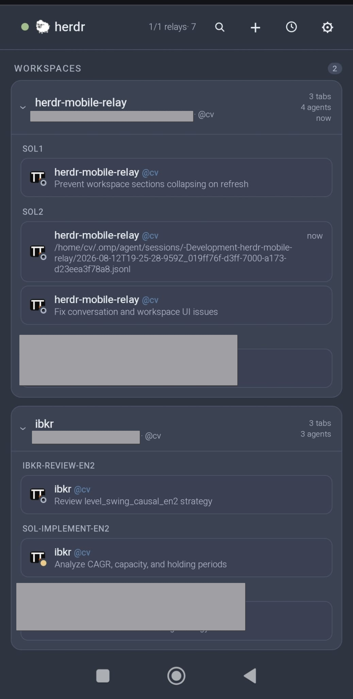
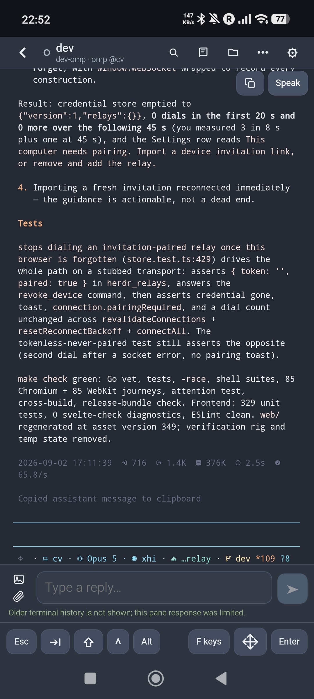
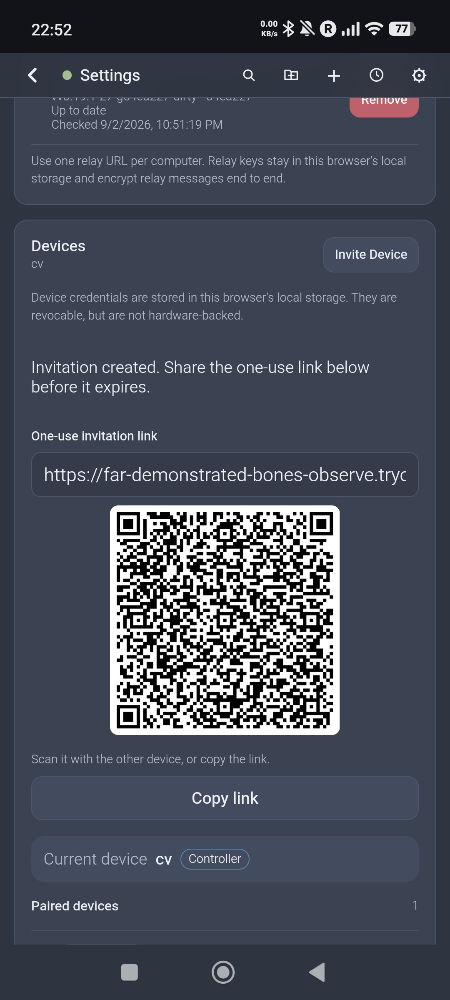

# Herdr Mobile Relay

[](https://github.com/0cv/herdr-mobile-relay/actions/workflows/check.yml)

Control [Herdr](https://herdr.dev) agents from your phone. Each Linux or macOS
computer runs its own relay; the phone connects to them and merges every agent
into one installable web app.

**Current version:** [`0.24.0`](https://github.com/0cv/herdr-mobile-relay/releases/tag/v0.24.0) · [Changelog](CHANGELOG.md)

> [!IMPORTANT]
> Native Windows is not supported. WSL2 may work but is not tested.

> [!WARNING]
> 0.20.0 replaces the shared relay key with per-device credentials and a new
> encrypted transport. It cannot be installed through the phone updater:
> [upgrade the relay manually and pair every phone again](docs/updates.md#upgrading-from-v0191).

## Get started in two minutes

Requirements: Herdr 0.7.5 or newer, Git, and `curl`. Herdr 0.9.0 is
recommended for the complete live JSON inventory and workspace-management
surface; the relay does not treat that recommendation as a new minimum.

The relay reports the installed Herdr client version separately from the
running local server version and protocol. A server upgrade can enable or
disable individual actions without changing the relay release.

```bash
herdr plugin install 0cv/herdr-mobile-relay
```

The setup menu opens automatically after installation and asks how your phone
should reach this computer:

```text
Choose a path:

  1. Cloudflare
  2. WebRTC
  3. Tailscale
  q. Exit, change nothing
```

Each path then lists only its own actions; **b** goes back.

To reopen the main setup menu later:

```bash
herdr plugin pane open \
  --plugin herdr-mobile-relay.events \
  --entrypoint setup \
  --placement zoomed \
  --focus
```

Open **WebRTC → Community WebRTC Gateway**. It is the recommended path: as fast
to set up as the temporary tunnel, with stable relay connectivity and no
Cloudflare account, domain, `cloudflared`, or tunnel configuration. If prompted,
choose the installed Herdr app that should host the phone UI. The relay starts
and prints a QR code.

**Cloudflare → Temporary Cloudflare Tunnel** is the fastest getting-started option for a
one-computer trial. It installs any missing user-level tools with confirmation,
starts the relay and bundled app, and prints a QR code.

If you already use Tailscale on your phone and computer, choose **Tailscale →
Always on Tailscale** for private HTTPS inside your tailnet, without a
Cloudflare account or gateway. Tailscale keeps the connection up in the
background, so the app reconnects quickly
([setup steps](QUICKSTART.md#use-tailscale-instead)).

Scan the QR with your phone. A relay started in the pane stops with Ctrl-C; an
installed background service keeps running.

The relay setup does not run `sudo` or need a Python, Node.js, or Go toolchain.
Treat the QR and its setup link as secrets: they contain a one-use device
invitation.

[QUICKSTART.md](QUICKSTART.md) has pairing detail and troubleshooting for all
three paths.

## What you get

| Agents | Terminal | Pairing |
| --- | --- | --- |
|  |  |  |

- Monitor and control agents across several computers, grouped by status and
  Herdr workspace, with agents that need input pinned on top.
- Answer approvals and structured plan questions from Codex, Claude Code,
  Hermes, Qoder, OpenCode, Oh My Pi, and Pi.
- Send prompts, terminal keys, and slash commands, including discovered Cursor
  commands and skills; attach screenshots, photos, and documents in cancellable
  batches. Optionally discover live Pi extension commands, skills, and templates
  by enabling **Settings → Pi Integration** for that computer, then reloading Pi
  ([CLI alternative](docs/slash-command-discovery.md#pi-runtime-commands)).
- Read and search native conversations for agents with a native history reader,
  including Hermes, OpenCode, Antigravity CLI, Grok, Oh My OpenCode plans and native Kimi Code journals.
  Kimi imports and human-engine-only histories use the Terminal fallback. Inspect workspace files, images, and Git diffs read-only.
- Manage workspaces and Git worktrees; start, rename, clear, and stop agents.
- Have the relay read responses aloud, even with the screen off.
- Pair every phone as its own named device — controller or read-only reader —
  each with its own notification rules, and revoke any of them.

With Codex 0.160 or later, start Codex with `codex --no-daemon` in Herdr panes.
Otherwise, Codex's shared background server runs Herdr's hooks outside the pane,
and Codex's Conversation is missing or shows another pane's session.
See [docs/herdr-core.md](docs/herdr-core.md) for the zsh snippet.

**New in 0.24.0:** Connect through Tailscale. The setup menu groups Cloudflare,
WebRTC and Tailscale; an open Conversation refreshes after a reconnect.

**[Full feature tour →](docs/mobile-app.md)**

## Mobile onboarding

https://github.com/user-attachments/assets/e52c4fd0-ef77-4852-bb43-078a7154eae8

The walkthrough follows setup from scanning the QR through the agent list,
terminal controls, and notification settings.

## Choosing how your phone connects

The setup menu starts with **Cloudflare**, **WebRTC**, and **Tailscale**. Select a path to see only its actions; use **Back** to choose another path.

| Choice | Needs | Best for |
| --- | --- | --- |
| Community gateway | no account, domain, or tunnel configuration; an installed app origin | the recommended stable, no-configuration relay path |
| Cloudflare tunnel | nothing for a temporary URL; a Cloudflare account and domain for a permanent hostname | the fastest one-computer trial or a permanent background service |
| Tailscale Serve | Tailscale on phone and computer, in the same tailnet | private HTTPS without Cloudflare or a gateway; fast reconnects |
| Your own gateway | a small VPS | dedicated bandwidth and control of the transport logs |

All four use end-to-end relay encryption. On either gateway the phone and the
computer then negotiate a direct peer-to-peer connection, leaving the gateway
with the fallback; Cloudflare tunnel traffic stays on Cloudflare. Tailscale
Serve is available only inside your tailnet.
[Set up Tailscale →](QUICKSTART.md#use-tailscale-instead).

- **[Transports explained →](docs/transports.md)**
- **[Permanent Cloudflare tunnel →](docs/cloudflare-tunnel.md)**
- **[Run your own gateway →](docs/gateway-self-hosting.md)**

## Agents with a non-default config directory

The relay runs as a background service and does not see a pane's
`CLAUDE_CONFIG_DIR`, `PI_CODING_AGENT_DIR`, or similar. If an agent's
conversation shows as unavailable or a profile's slash commands are missing,
point the relay at that profile with `HERDR_*_CONFIG_DIRS`:
**[Agent directories →](docs/agent-directories.md)**

## Documentation

| Page | What is in it |
| --- | --- |
| [QUICKSTART.md](QUICKSTART.md) | The fast path, start to paired phone |
| [docs/mobile-app.md](docs/mobile-app.md) | Every feature: agent list, terminal, devices, speech, notifications |
| [docs/transports.md](docs/transports.md) | Cloudflare, Tailscale, gateways, direct WebRTC |
| [docs/herdr-core.md](docs/herdr-core.md) | A second relay for herdr-core (herdr-app) beside the TUI relay |
| [docs/cloudflare-tunnel.md](docs/cloudflare-tunnel.md) | The stable tunnel wizard, DNS, and teardown |
| [docs/gateway-self-hosting.md](docs/gateway-self-hosting.md) | Deploying and operating a gateway |
| [docs/agent-directories.md](docs/agent-directories.md) | Agents that use a non-default config or profile directory |
| [docs/slash-command-discovery.md](docs/slash-command-discovery.md) | Bounded slash-command discovery and incomplete-catalog guidance |
| [docs/updates.md](docs/updates.md) | Verified releases, phone-driven upgrades, upgrading from 0.19.1 |
| [docs/security.md](docs/security.md) | What is encrypted, device pairing, what an intermediary sees |
| [docs/development.md](docs/development.md) | Building, testing, and contributing |

## Security in one paragraph

Prompts, terminal output, uploads, and push details are encrypted end to end
between the phone and the relay. Whatever carries the traffic — a Cloudflare
tunnel, a gateway, or Tailscale Serve — observes connection metadata only, never
plaintext; on the direct path no application data reaches it at all, though a
gateway still answers address discovery. Paired credentials distinguish
controller and reader devices, mutations default to controller-only, attachment
references stay bound to the terminal and agent session that created them,
and the app can require device verification before it reconnects.
[Details →](docs/security.md)

## License

[GNU Affero General Public License v3.0 or later](LICENSE).
