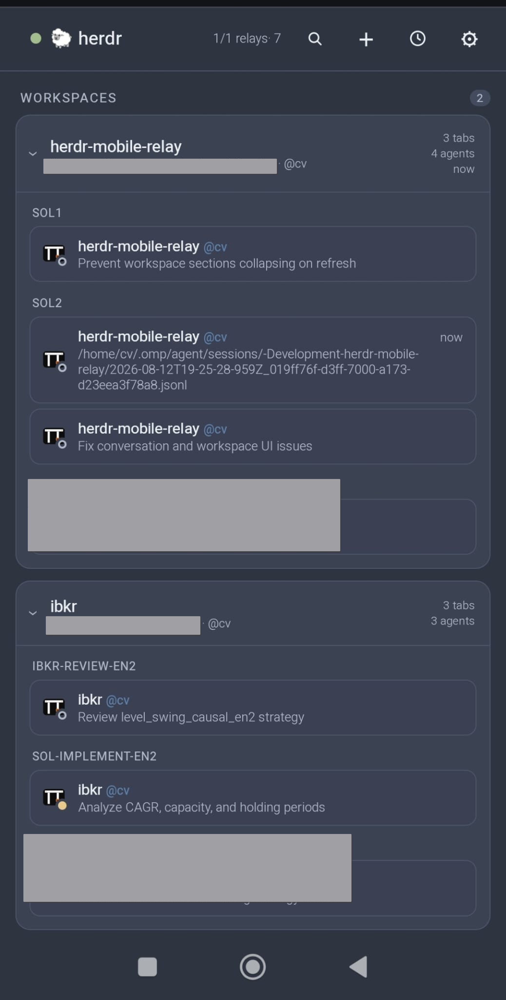
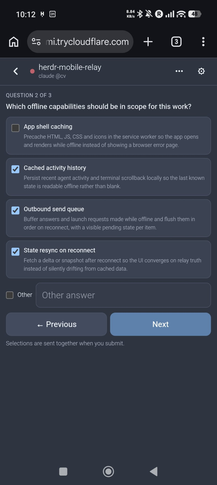
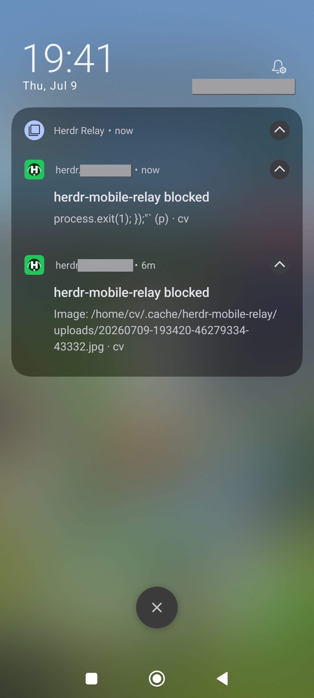
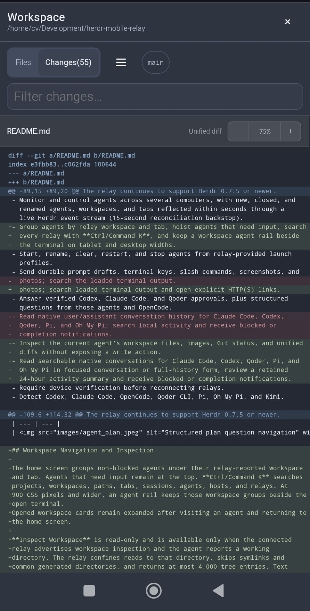
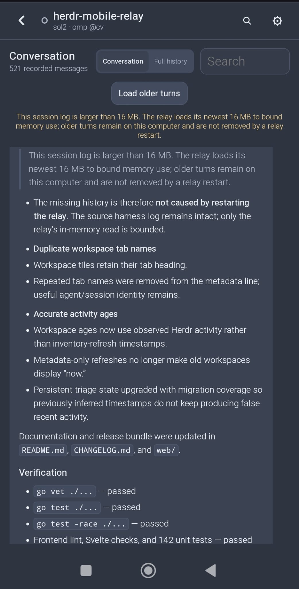
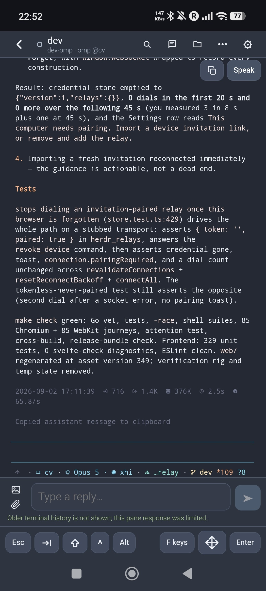
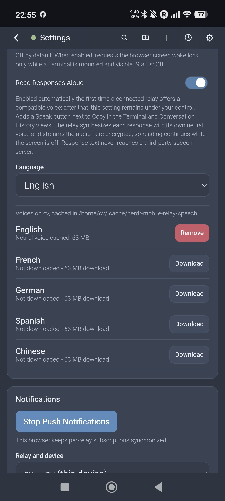
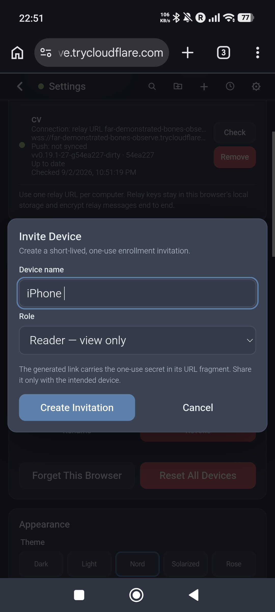
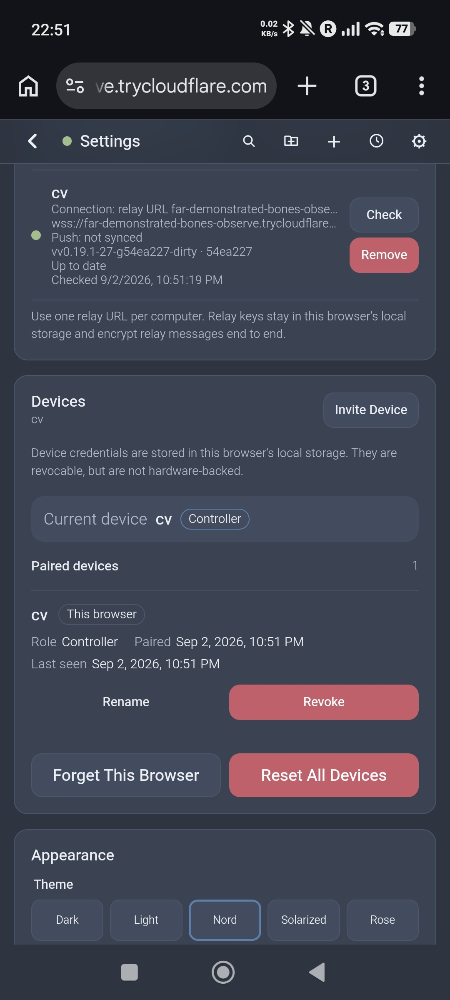

# The Herdr Mobile Relay app

What the phone app does once a relay is connected: the agent list, read-only
workspace inspection, and the mobile terminal. Read this if you have finished
setup and want to know what every screen and control is for.

## What it does

- Monitor and control agents across several computers, with new, closed, and
  renamed agents, workspaces, and tabs reflected within seconds through a
  live Herdr event stream.
- Start, rename, clear, and stop agents from relay-provided launch profiles.
- Send prompts, atomic terminal text-and-key input, slash commands, and
  cancellable attachment batches; drafts survive locally for 48 hours. Search
  loaded terminal output and open explicit HTTP(S) links.
- Answer approvals bound to the current prompt, command, and ordered choices
  from Codex, Claude Code, Qoder, Oh My Pi, and Pi, plus structured questions
  from those agents and OpenCode.
- Inspect the current agent's workspace files, images, Git status, upstream
  ahead/behind counts, and unified diffs without exposing a write action.
- Read searchable native conversations for Claude Code, Codex, OpenCode,
  Qoder, Pi, Oh My Pi, Oh My OpenCode, Hermes, Cursor Agent, Antigravity CLI and native Kimi Code in focused
  conversation or full-history form; validated Oh My OpenCode plans appear with
  their current task states.
- Configure durable notification categories, settle delay, cooldown, snooze,
  and a neutral delivery test separately for each paired relay and device.
- Pair named controller or reader devices. Reader devices can inspect agents,
  conversations, and workspaces; manage their own notifications; and revoke
  themselves, but cannot control agents or administer other devices.
- Optionally require device verification before the app connects at open, and
  again before the interface unlocks on resume. A resume keeps the existing
  encrypted session, so verifying is instant rather than a fresh connection;
  the unlock screen covers the page and the terminal stops streaming until it
  succeeds.
- Optionally request a screen wake lock only while a terminal is visible, or
  read responses aloud in English, French, German, Spanish, or Chinese. The
  relay synthesizes the audio and streams it to the phone encrypted - real
  media playback that keeps reading with the screen off, and response text never
  reaches a third-party speech server. On hosts with a published Piper runtime,
  setup downloads the neural engine and English voice into
  `$XDG_CACHE_HOME/herdr-mobile-relay/speech` when `XDG_CACHE_HOME` is set, or
  `~/.cache/herdr-mobile-relay/speech` otherwise. Relay updates never touch the
  cache. Reading aloud switches itself on the first time a relay reports a
  voice; after that the setting decides. Every other
  language is downloaded on demand, from Settings on the phone or with
  `relay/speech-voices.sh --languages fr`, and Settings lists what a relay has
  cached and removes voices one language at a time. If the runtime was cached
  before a failed extraction fix, run
  `relay/speech-voices.sh --reinstall-runtime`; this replaces only the engine
  and keeps all downloaded voices. Stock Apple Silicon uses macOS `say` and does
  not offer neural downloads unless Piper is already installed. Without a
  neural voice the relay falls back to espeak-ng, espeak, flite, or macOS `say`;
  a language it cannot speak is reported in Settings instead of failing at the
  Speak button.
- Detect Codex, Claude Code, Devin, OpenCode, Qoder CLI, Pi, Oh My Pi, and Kimi.

| Agents |
| --- |
|  |

| Plan Questions | Notifications |
| --- | --- |
|  |  |

| Git Inspection | Native Conversations |
| --- | --- |
|  |  |

| Terminal | Read Aloud |
| --- | --- |
|  |  |

### Cursor picker filters

**Send filter text** appends to an open Cursor model picker without pressing
Enter or selecting a model. It supports up to 32 ASCII letters, digits, spaces,
and `.-_/+:()[]`. Trailing spaces, multiline text, and other characters are
rejected without trimming. Other picker layouts may be refused.

The relay sends separate characters at least 150 ms apart and checks the live
filter after visible characters. Interior spaces are verified with the next
visible character. Terminal readback hides trailing spaces already in the
picker: if the first visible character reveals an unexpected prefix, delivery
stops and is reported as uncertain. Inspect the picker before sending more;
the full draft is not restored after uncertain or partial delivery.

Terminal controls are locked while sending. Select separately afterward, or
press Escape to close the model picker. Relay commands are serialized per pane,
but desktop typing is not locked: avoid typing there during delivery. Fresh
reads detect observed interference, not an atomic guarantee against it.

## Settings

**Pi Integration** is a computer-side setting for each relay, not a phone
preference. It defaults to off. Paired controllers can enable it for all known
Pi agent directories; readers see the state read-only. Each profile reports
installed, up to date, not installed, or refused with a reason. The switch is
on when any known profile has a valid relay-owned marker, including a manual
CLI installation; a partial failure does not hide successful profiles.

It enables live Pi commands, progress, notices and the unconfirmed phone reply
path for blocked **Needs inspection** panes. Reload or restart Pi after changes.
The app only shows a reload hint and never sends `/reload` or other pane input.
At relay startup, installed owned copies refresh from the current bundle.
Disabling removes only owned files, never Pi settings or other integrations.
The computer-side CLI alternative is `bash relay/setup.sh --pi-install [agent-dir]`
or `--pi-remove`. See [agent directories](agent-directories.md) for profile lookup
and [Pi discovery](slash-command-discovery.md#pi-runtime-commands) for safety.

## Paired devices

Remote relay URLs require device pairing and end-to-end encryption, even over
`wss:`. An empty key without device credentials enables plaintext development
only at `localhost`, a `127.x.x.x` address or `[::1]`; remote destinations are
refused before a socket opens.

An encrypted direct `wss:` connection can report that its TLS endpoint rejected
the device. The app stops automatic retries and asks for a new invitation,
without deleting the saved credential. This trusts the configured relay URL's
TLS endpoint, not a gateway's close text and not an E2EE rejection proof.
Plain `ws:` and gateway/WebRTC closes remain untrusted and recoverable.

A controller opens **Settings → Devices → Invite Device** to create a ten-minute,
one-use invitation. The relay draws both a complete setup link and its QR code;
share either privately. The first browser that completes the encrypted
handshake consumes the invitation. Create a separate invitation for every
additional controller or reader, or print the setup link again on the
computer: every print arms the relay's bootstrap for one more phone.

| Invite a device | Paired devices |
| --- | --- |
|  |  |

An uncaught phone-side error appears in a bottom **App error** banner because
mobile browsers often provide no useful console. Copy or photograph its text
for a bug report, then tap the banner to dismiss it; a later independent error
will display a new banner.

## Opening links from other apps on iOS

External links open in Safari, not the installed Home Screen app. To use those
links, pair Safari as its own device: in the Home Screen app, choose
**Settings → Devices → Invite Device**, open that invitation in Safari, then
choose **Pair this browser instead** and confirm. Safari is listed and revocable
separately; its one-use invitation cannot also pair the Home Screen app.
Safari may clear this site's storage after a week without use; invite it again
if that happens.

Link to an agent with `https://<app>/#notify=<url-encoded {"pane_id","host"}>`,
where the fragment value is `encodeURIComponent(JSON.stringify({ pane_id, host }))`.
Use the agent's pane ID and computer host name. Once Safari is paired, opening
this link from another app takes you to that agent.

## Workspace navigation and inspection

The home screen keeps agents that need input visible at the top. By default,
each workspace below them appears once — mixed — with a dot for its most
notable session: done, then working, then idle. The **Home Workspaces**
setting can separate them into Done, Working, and Idle sections instead; both
layouts retain the workspace and tab hierarchy. On a phone, tap the
magnifying-glass button to search projects, workspaces, paths, tabs, sessions,
agents, hosts, and relays.
At 900 CSS pixels and wider, an agent rail keeps those workspace groups beside
the open terminal.

A workspace card names its computer on the first line, beside the workspace
label, and gives the second line to the workspace directory. Agent rows inside
the card, including those nested in a linked worktree, show their own working
directory rather than repeating that computer name. A directory inside the
computer's home directory is written `~/code/app`, matching how the relay's
directory browser labels it; every other directory is written in full. An
agent that reports no directory keeps its name on that line.

When the relay advertises tab ordering, press and hold an agent card until its
tab lifts, then drag to reorder the tab in Herdr; a plain tap still opens the
agent, and Alt+arrow keys on a focused card provide the same control. The
change is applied to the desktop immediately.

Opened workspace cards remain expanded after visiting an agent and returning to
the home screen.

The workspace cards come from Herdr's complete workspace inventory rather than
being inferred from active agents. A workspace therefore remains visible when
it contains only a shell or no running agent; the phone does not expose that
shell as a generic terminal.

Open **Workspaces** from the folder button in the header to:

- open **Create Workspace**, choose a directory and label in its dialog, then
  confirm a non-focusing workspace with the native initial tab;
- press and hold a workspace card until it lifts, then drag it into place;
  Alt+arrow keys on its reorder handle provide the same accessible control;
- rename or close a workspace, or start an agent as a second tab in a selected
  workspace;
- open **Worktrees** in a dialog, create a branch-backed worktree, or open an
  existing checkout as a non-focusing Herdr workspace; Git worktrees are flat,
  so the dialog is offered on repository workspaces only, never inside a
  linked worktree;
- close a linked-worktree workspace without deleting its checkout, or remove
  the checkout while retaining its Git branch.
- closing a repository workspace with linked worktrees first offers **Close
  Workspace Group**. The second dialog lists the current group and must be
  confirmed separately; Herdr closes the group that is open when the operation
  runs, so membership can change after confirmation. It never removes Git
  checkouts or branches.

Linked worktrees are nested below their repository workspace on both the home
screen and the Workspaces page, drawn as a tree with connector rails that
match Herdr's parent/child presentation. Rows repeat neither the repository
name nor a checkout path that merely restates the worktree's label; a path
appears only when it differs. Dragging a repository moves that complete group
atomically when Herdr exposes `workspace.move_block`; older compatible Herdr
versions can still move a standalone workspace and ask for an update before
moving a linked group.

Normal worktree removal refuses a dirty checkout. **Force Remove** is offered
only after that refusal and requires a second confirmation because it discards
uncommitted checkout changes. Creating a worktree uses Herdr's configured
worktree directory; the phone cannot provide an arbitrary checkout path.

The separate **Remove Worktree** action is the destructive checkout operation.
It retains the Git branch and is subject to the dirty-checkout and force-remove
rules above. Closing a workspace and removing its worktree are never the same
operation.

## Herdr compatibility

Settings reports the installed Herdr client version separately from the running
server version and protocol. It also reports the generation of the relay's
stable JSON endpoint contract and the reason each feature is supported,
unsupported, or still unknown. An endpoint generation is not a claim that all
optional features are available.

Agent, pane, workspace, and tab inventory uses Herdr's JSON operations. The
mobile terminal remains a separate binary-stream compatibility path, so a
server can support inventory and workspace controls while its terminal
transport is unavailable. The event stream is subscribed before each snapshot;
after a reconnect the relay takes a fresh snapshot rather than replaying every
notification missed while disconnected.

**Inspect Workspace** is read-only and is available only when the connected
relay advertises workspace inspection and the agent reports a working
directory. The relay confines reads to that directory, skips symlinks and
common generated directories, and returns at most 4,000 tree entries. Text
previews are limited to 1 MiB and image previews to 5 MiB.

Git inspection disables hooks, pagers, text conversion, external diffs, lazy
fetches, and user/system Git configuration. Status is limited to 2,000 changed
files, individual unified diffs to 1 MiB, and Git commands to eight seconds.
On narrow screens, swipe the file or changed-file sidebar left to collapse it;
the adjacent sidebar button restores it. Pinch the diff or use its zoom
controls to resize it without changing the rest of the app.

## Mobile terminal

By default the phone shows each pane at the size Herdr gives it. Controller
terminals keep the desktop width, with column alignment preserved, and scroll
horizontally. Read-only reader panes wrap desktop-width text to the phone width
instead. Prompts, keys, approvals, uploads, terminal reading, and Conversation
work the same in both layouts.

**Resize Session** (Settings → Terminal, on by default, saved per device) lets
a controller phone resize the shared terminal's width to fit itself while it has
the pane open. A saved off choice stays off. Turn it off to avoid these costs:

- **The laptop and SSH views of that pane look garbled until the phone lets
  go.** Herdr has no way to resize a pane for one viewer, so the relay resizes
  the pane's terminal device directly while Herdr's own grid stays at the
  layout size ([issue 60](https://github.com/0cv/herdr-mobile-relay/issues/60)).
- Agents redraw at the new size and may leave narrow copies of their output in
  the scrollback, which cannot be erased afterwards. Resizing may also truncate
  scrollback and lose older output.
- The relay attempts to restore the previous size when the phone leaves the
  pane: about ten seconds after closing the terminal (so stepping straight
  back in does not resize twice), immediately when you turn Resize Session
  off or the phone disconnects, and within two minutes if the phone just goes
  silent. Dimensions that differ from the last leased value are left alone;
  preserving local changes is best effort, not a guarantee. If the
  relay cannot confirm the pane is still the terminal it resized, it writes
  nothing; after about thirty seconds of failed attempts it logs a warning,
  and a normal local resize puts the pane right.
- It is available only on relays that advertise it (Linux and macOS relays
  from this release on). Elsewhere the switch has no effect and the terminal
  keeps the default layout; no error is shown.

While a pane is leased, a hidden page keeps renewing for five minutes, because
desktop Safari reports an occluded window as hidden and brief app switches
must not resize the shared pane. Several phones on one pane get the narrowest
requested size. Readers never resize anything.

**Lease Terminal Height** (off by default, available only with Resize Session
on and a relay that supports it) also fits the height, so full-screen agents
redraw to the phone instead of serving a mostly empty desktop-sized grid. Each
height change can strand a stale copy of an inline agent's status bar (omp,
Claude Code) in the scrollback. While the height is leased, the on-screen
keyboard never shrinks it. Turning Resize Session off disables height leasing
without clearing its saved preference: a checked but disabled height switch
is inactive and is reused when Resize Session is enabled again.

Older apps (0.22.7 and earlier) resized automatically whenever a relay offered
it. This relay no longer offers that, and refuses any resize request that does
not carry the new opt-in, so an older app keeps the default layout. Design,
safety checks and residual risks are in
[pane-size-leasing.md](pane-size-leasing.md).

Terminal History keeps 100, 500, 1,000, or 10,000 lines in the terminal view.
1,000 is the default and the ceiling on the gateway-relayed path; direct
connections can use 10,000. The "older history" notice reports when rows beyond
the served window exist. Use **Copy** for the latest response or
**Conversation History** for clean, searchable earlier turns.

In **Settings → Agents → Default View**, choose **Terminal** or
**Conversation** for new agent openings. Conversation is the initial default
when history is available, across all supported providers; a saved choice of
Terminal still wins. In
**Manage agent → Default View**, choose **Use default** or set a preference for
that pane; the menu is available from both Terminal and Conversation. These
preferences are stored only in this browser/app on this device and apply across
its connected computers. A pane preference belongs to the pane, not its harness,
and changing its session or name does not reset it. A new or replaced terminal
inherits the global default.

Preference changes affect the next opening, not the screen currently shown, and
manual Terminal/Conversation switching does not change the saved preference.
Unsupported agents, agents without a session, or unavailable transcripts open
in Terminal instead. Terminal remains one tap away for fullscreen TUI pickers
and interactions that need live screen text.

For supported agents, the terminal header opens **Conversation History** after
the agent reports a session. It opens on the newest turn and stays there as
turns arrive; scrolling up to read holds your position until you return to the
actual bottom. Scrolling to the bottom of an older loaded window reveals the
next newer window without losing the visible message anchor; repeat until the
newest messages, then following resumes. No jump button is needed.
**Conversation** keeps each user prompt and the latest agent answer from
that exchange. Questions the agent asked (Claude Code AskUserQuestion) stay
visible with the chosen answer. **Conversation** is the initial mode. **Full history** is an explicit
preference that shows every recorded message with collapsible tool activity
(agent questions stay expanded);
the app remembers either mode on this device. Both use an escaped Markdown subset, search filters the
currently displayed view, each fenced code block has its own copy control, and
each message can copy its original Markdown.
Conversation and Full history share the Terminal composer: multiline prompts,
locally shared drafts, slash-command suggestions, photos/files and pasted images.
Slash suggestions fill the draft without sending it; Ctrl/Meta+Enter sends it.
Both views prevent sending until an upload has finished inserting its references,
and prevent uploads while a prompt is sending. Missing target identity disables
attachments and sending with an explanation; upload errors remain visible even
when an agent interaction locks ordinary input.
The composer accepts one or more validated attachments from the file picker or clipboard. Supported
files are images, UTF-8 text, Markdown, PDF, JSON, CSV, DOCX, XLSX, PPTX, ODT,
ODS, and ODP. Uploads show per-file progress, can be cancelled, and interrupted
files restart from the beginning. Live uploads are bound to the exact target
generation; after restart, opaque references remain bound to the server
session, pane, terminal, and agent session that created them. The relay
revalidates the current exact target before resolving a reference. The history
does not render attachments inline. Structured questions and approval buttons
are available directly in both Conversation modes. Manual terminal text, raw
screen previews and the terminal-key row stay in dedicated Terminal. Conversation
keeps the normal composer without a duplicate textual activity footer; the
header light indicates activity. Send-button busy state, actionable failures and
pending or uncertain delivery warnings remain. Reader devices cannot use input,
upload, hidden-value or response controls.

Visible Pi extension notices appear in both modes, including recent, older and
live history. Only text from explicit `display:true` custom messages is shown;
hidden messages and private details are excluded. For a blocked Pi pane with
unknown focus, a controller may send text through a live exact-session Pi bridge
capability after a fresh normal-input check. This never sends terminal keys,
attachments or hidden input. The UI reports **Sent to Pi — not confirmed** and
fences further sends until explicit **I checked — allow another send**
acknowledgement. Transcript messages, even identical later native user messages,
do not prove delivery and never clear this fence. Acknowledging never resends.
Before dispatch, the Pi bridge saves only an exact-target uncertainty marker on
this browser, never reply text, transcript content or bridge credentials. Reloading
restores the fence, including when the page closed before the result arrived.
Only acknowledgement removes that target's marker; there is no automatic expiry.
Same-origin pages use an exclusive Web Lock for the target through dispatch and
result handling. Acknowledgement takes that same lock, so another page cannot
clear a pending send. Capabilities and safe input are rechecked inside the lock.
If browser storage or Web Locks are unavailable, Pi bridge sending stays blocked
with an error.
Clearing browser data or using another browser loses these local markers. Other
Terminal delivery fences remain page-memory-only. The updated bridge must be
loaded by the relevant Pi session before this path is
available. Ready/working panes and structured controls keep their normal routes.

Hidden prompts use the same masked, non-persisted field in both views and
require the relay's `secret_input` capability. Ordinary draft persistence pauses
while no-echo is active; text changed during that prompt stays unsaved even after
the prompt clears. Conversation checks only the last 30 terminal lines every two
seconds, without streaming terminal frames. Saving also pauses until a fresh
check confirms ordinary input; missing, disconnected or three-second-old state
cannot authorize saving. Text changed during that pause stays unsaved until
cleared. A pre-existing draft is preserved when switching views.
Fullscreen TUI pickers and detected live-screen menus remain Terminal-specific;
the UI points there only when live screen text is needed. The **Terminal**
header button switches to the same agent without adding repeated view toggles
to browser history.

Hidden reasoning, injected system records, and sidechain turns remain excluded.
Claude continuation links are followed within the selected project, so a stale
anchor session can show newer continuation sessions in order. Conversation
History opens with a small recent page (currently up to 24 raw records), without
eagerly crawling tool-only pages or incomplete exchanges. Older history loads
on upward scroll demand or explicit **Load older turns**, preserving the visible
anchor. Changing modes or a short viewport does not automatically fetch older
pages. A small in-memory preview can appear immediately on
a warm reopen while the current latest page is checked; it is bounded, never
persisted by the browser, and never authorizes a cursor or proves that history
is empty. Loading, preparation, context search, errors, and the true beginning
of the available source have separate status messages. Search filters loaded
content only. Older browsing keeps a fixed chain snapshot and continues across
large parent files through the local index; a missing, invalid, ambiguous,
cyclic, or bounded-out continuation remains readable and displays an
incomplete-history warning. Reads are confined to known session directories and
the newest 16 MiB of very large logs. When that bound omits older turns, they
remain in the harness log on the computer. Preparation reports progress and
never blocks the relay's live terminal paths. Snapshot pages remain stable while
new turns are written, and storage, source-change, corruption, oversized-record,
and expired-cursor states are reported without exposing transcript paths or raw
records. Pagination uses only short-lived opaque cursors; the app never
constructs a cursor from a displayed entry ID. OpenCode and Hermes retain their
native database pagination semantics while binding cursors to the selected
source identity. OpenCode 2.x selects a recent page with lookahead, without a
session-wide count; its total is unknown rather than estimated. Hermes and
unindexed OpenCode 1.x may scan, sort, validate or deduplicate the entire session
before selecting the recent page. Their cold-open cost grows with history size;
a small response is not a bounded cold database read. Kimi Code likewise folds
the entire bounded native main-agent journal,
including validated 2.2.0 undo branches. Imported and human-engine-only journals,
unknown structural records and incomplete branch trees are unavailable, with
Terminal as the fallback. Session selection, privacy and replay bounds are
[documented separately](conversation-activity.md#kimi-code-recorded-history).

### Conversation activity updates

The updated optional integration supports stock Pi 1.3.0 public events and
active-branch history. While Full history is open, in-progress Pi text and tool
progress stream to authorized paired devices, matching what the desktop TUI and
Terminal mirror already show; later completion-time redactions cannot retract
text already delivered. Other native readers are visibly recorded-only, not
token streams.

| Provider | Conversation update path |
| --- | --- |
| Pi with the optional integration | Live public events and recorded active branch |
| Pi without the integration; Claude Code; Codex; Cursor Agent; Qoder; Oh My Pi | Recorded JSONL changes checked every 250 ms |
| OpenCode 1.x/2.x SQLite, including mixed stores; Hermes | Main/WAL changes checked every 250 ms; persisted new/edited messages and tool states |
| Oh My OpenCode | Session JSONL checked every 250 ms; validated plan changes refresh the snapshot |
| Kimi Code native 1.5 / legacy-engine 1.4 | Main journal checked every 250 ms; validated undo branches reset history; recorded complete responses, not tokens |

The recorded feed includes reader aliases such as `cursoragent`, `qodercli` and
`ohmypi`, `hermesagent` and `ohmyopencode`. OpenCode keeps the reader's
per-session table selection; loose JSON-file stores have no reader. Database
updates use bounded rowid append queries and indexed checks of loaded message
IDs, including older pages (20,000 IDs shared by viewers). Hermes checks a bounded
per-session rowid window using a verified index because it has no message-update
index; without that index it uses a bounded global window and resets on overflow. Missing indexes or exceeded
row/part budgets request a fresh snapshot. Edits outside the tracked loaded
window may wait for normal paging; explicit snapshots/paging retain native totals.
It never requests terminal input, scrolling or resizing. These are
scheduling intervals, not token-stream or physical-phone latency guarantees.
The browser keeps local reading available while disconnected and mounts bounded
loaded-history windows.
[Source capabilities, limits, privacy, and optional activation/rollback](conversation-activity.md).

### Conversation history cache and limits

The relay never edits a provider transcript or native database to serve this
view. SQLite reads use read-only mode; JSONL reads use captured regular-file
handles and reject symlink retargeting. The optional derived cache lives under
`<cache>/conversation-history`, which is created as mode `0700`; each bbolt
snapshot is a regular mode `0600` file. Startup removes abandoned snapshot
files, and shutdown and expiry remove the derived index, not the source
transcript.

Default bounds are one active preparation, four queued preparations, a
30-second client-interest lease, 15-minute snapshot expiry, and 15-minute
cursor expiry. A snapshot is limited to 512 MiB and all snapshots together to
1 GiB. A JSONL record is limited to 16 MiB, a recent window to 16 MiB, a page
to 200 entries, and a response to 2 MiB. Exceeding a cache limit fails the
preparation with a retryable capacity result; it never truncates or deletes a
provider source. A cancelled or abandoned preparation stops at scan and index
checkpoints.

Recent pages report no total when only a bounded tail was read. Prepared and
native pages report their visible-entry total when the source supplies one.
`source_truncated` identifies a bounded JSONL tail, while diagnostics count
oversized or corrupt records and tool/payload omissions. Valid entries remain
available when a later record or an OMO plan update is invalid. A failed
preparation retains its continuation cursor so **Retry** does not lose the
already displayed recent turns. The relay also retains a bounded, in-memory
recent-range projection cache (four projections, 16 MiB per item, 64 MiB total,
and a 60-second idle expiry by default). It rechecks containment, identity, and
the exact range digest before reusing it; the cache contains no source handles,
cursors, or transcript files and is cleared on relay shutdown.

Cursors are signed, opaque, scoped to the provider, workspace, session, pane,
server session, terminal, and target generation, and contain an expiry and
source revision. They bind a file range digest, snapshot identity, or native
source identity; appends are accepted only when the captured range remains
stable. Tampering, scope changes, expiry, truncation, replacement, rewrite,
and symlink retargeting are rejected. OpenCode and Hermes keep their native
pagination anchors while applying the same scope and source checks.

Terminal Refresh controls how often the relay checks a visible pane: 100 ms,
250 ms, 500 ms, or 1 second; 250 ms is the default.

**Find** searches the rows loaded into the current terminal view, highlights
visible matches, and moves between the first 1,000 of them.

Explicit HTTP(S) URLs in terminal output become external links with opener and
referrer isolation. When the last terminal lines name supported key hints such
as arrows, Enter, Esc, Tab, Y/N, or a modifier chord, the app offers matching
one-tap actions through the same ordered key path. Detected actions can be
dismissed and never replace verified approval or structured-question controls.

The terminal controls send **Esc**, **Tab** (`⇥`), **Enter**, arrow keys, and
**F1**–**F12** behind the **F keys** row. **Shift** (`⇧`), **Ctrl** (`^`), and
**Alt** can be combined, remain armed for repeated input, and apply to typed
characters or any available terminal key — arm `^` and type `c` to interrupt.
A live status confirms the exact chord. Toggle the modifiers off or move focus
to the composer to disarm them.

While the composer cannot send — the agent awaits an approval or question
answer, or its pane needs inspection — the **Keyboard** button
joins the key row. It types one line of literal text into whatever control has
focus in the terminal, with **Enter** sent separately, and **Close** returns to
the composer. It also stays while an earlier terminal send is unconfirmed, so
you can check the terminal before sending again; delivery warnings point to it
by its icon. Agents that accept prompts do not show it.

When the pane's last line is a prompt that echoes nothing — `[sudo] password
for …`, an SSH passphrase, `gpg`, a PIN — the app names it and offers a masked
field, even though the ordinary composer stays locked on a screen it cannot
classify. The value is typed into the pane as individual keystrokes followed by
Enter. Nothing is sent until you press Send, and the value is never stored on
the phone, never inserted as pasted text, and never recorded in activity or the
audit log. Relays older than this feature say so and leave the prompt to the
computer.

**Copy** captures the agent's latest completed response without ANSI control
sequences. When the relay advertises response copy and the agent is one of
Claude Code, Codex, Kimi, Oh My Pi, Pi, or Qoder, it runs that agent's own copy
command; every other case takes the visible terminal output. The agent command
refuses a busy composer, so it cannot interrupt an in-flight turn.
